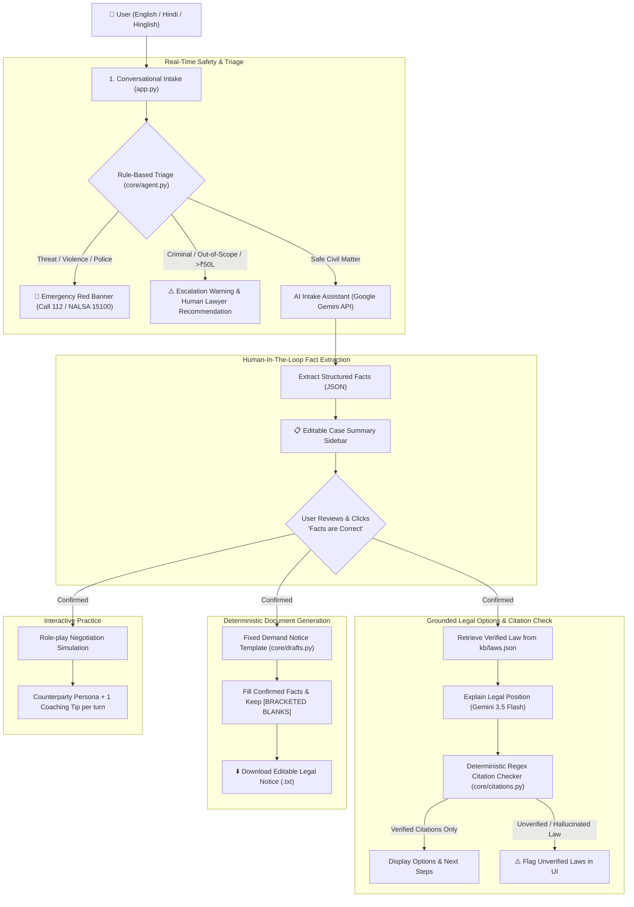

# ⚖️ Nyay Saathi — AI Legal Helper Platform

> **An AI legal companion for India that provides structured, verifiable legal information and draft notices for everyday civil disputes — designed with strict anti-hallucination safeguards, deterministic citation verification, and human-in-the-loop control.**

*Legal Information, Not Legal Advice · Bilingual (English & Hindi / Hinglish)*

---

## 📌 Executive Summary & Why I Built This

Most ordinary citizens in India face everyday civil disputes—unreturned rental deposits, withheld salaries, or refused refunds for defective goods—where the money at stake is often smaller than a legal consultation fee. Going to a lawyer is expensive and intimidating, while traditional generative AI chatbots are prone to hallucinating fictitious legal sections, citing repealed colonial-era acts, or making dangerous guarantees.

To solve this, I designed and built **Nyay Saathi** ("Companion for Justice"). It is a full-stack AI legal helper engineered to guide everyday citizens through their options, extract undisputed facts, and generate formal legal demand notices—**without ever inventing laws, guessing facts, or pretending to be a licensed attorney**.

### 🎯 Problems I Scoped & Solved

I specifically targeted three high-volume, actionable civil disputes where pre-litigation demand notices and statutory dispute forums are most effective:

1. **Security Deposit Not Returned by Landlord**
   - Contextual guidance based on the *Model Tenancy Act, 2021* (advisory framework across states) and summary civil recovery under *Order XXXVII of the Code of Civil Procedure, 1908*.
   - Explains state-specific tenancy nuances and Lok Adalat pre-litigation routes.
2. **Defective Products & Refund Refusals (Consumer Disputes)**
   - Statutory grounding in the *Consumer Protection Act, 2019* (Sections 2(7), 2(10), 2(11), 34, 35, 69).
   - Practical escalations to the **National Consumer Helpline (1915)** and digital grievance filings via the **e-Jagriti** portal for claims up to ₹50 Lakh.
3. **Unpaid Salary & Wrongful Wage Withholding**
   - Citing the *Code on Wages, 2019* (Sections 17 & 45), detailing limitation periods (3-year wage claim windows), formal demand notice delivery, and labor commissioner conciliation.

---

## 🏗️ Architecture & Workflow

I designed Nyay Saathi around a **5-stage modular pipeline** that couples modern Large Language Models (LLMs) with deterministic code checks. The model handles empathetic conversation and summarization, while rigid code and curated legal databases handle legal precision and document drafting.



---

## 🛠️ Detailed Workflow Breakdown

### 1. Conversational Intake & Empathy
- The user describes what happened in natural language (English, pure Hindi, or mixed Hinglish).
- I prompt the model to ask only **1 or 2 targeted questions at a time** (who, when, what amount, what proof exists such as WhatsApp chats, receipts, or agreements).
- **Tone:** Empathetic, calm, non-judgmental, and plain-spoken.

### 2. Zero-Latency Rule-Based Triage
Before any message reaches the LLM, my Python triage engine screens the text using deterministic regex boundary matching:
- **Urgent / Criminal Trigger:** Keywords like *police, arrest, FIR, threat, maarne, jaan se, goonda, suicide, forcefully, thrown out*. Displays an immediate emergency alert with **112** and **NALSA 15100**.
- **Out of Scope Trigger:** Keywords like *property dispute, zameen, divorce, talaq, custody, bail, cheque bounce, murder*. Clearly informs the user this requires a human lawyer.
- **High-Value Trigger:** Claims exceeding ₹50 Lakh (exceeding District Consumer Commission thresholds).

### 3. Human-in-the-Loop Fact Summary Panel
- Once sufficient details are shared, the user clicks **"Build case summary"**.
- The LLM extracts the conversation into a strict JSON schema (`category`, `parties`, `dates`, `amounts`, `proof_available`, `missing_info`).
- The extracted JSON is loaded into an **interactive, editable text area in the Streamlit sidebar**.
- **Hard Gate:** The user must explicitly inspect, correct, and click **"✅ Facts are correct"** before the legal options and notice drafting tabs unlock.

### 4. Grounded Legal Options & Regex Citation Verification
- When analyzing options, the prompt injects **only** the curated knowledge base entries (`kb/laws.json`) relevant to that dispute category.
- **Anti-Hallucination Regex Guard (`core/citations.py`):** Rather than trusting another LLM judge, I wrote a deterministic regex parser that inspects the generated response for:
  - Statutory sections (`Section`, `धारा`, `s.`, `Sec.`)
  - Order / Article mentions (`Order XXXVII`, `Article 21`)
  - Full Act names (`... Act, YYYY`)
  - Common case-law citation patterns (`X v. Y`, `AIR 19xx`, `SCC`)
- Any section, act, or citation not explicitly present in `kb/laws.json` is flagged with a warning in the UI, protecting the user from fictitious legal assertions.

### 5. Template-Driven Demand Notice Drafting
- **No LLM text generation for legal documents:** I completely decoupled drafting from generative AI.
- Legal documents are generated via strict, attorney-reviewed Python text templates (`core/drafts.py`).
- Every confirmed fact is slotted into place. Any missing detail is rendered as `[SQUARE BRACKET PLACEHOLDERS]` (e.g., `[DATE OF NOTICE]`, `[TOTAL SECURITY DEPOSIT PAID]`).
- The LLM is only utilized to translate the generated draft into formal Hindi when requested.

### 6. Opposing Party Negotiation Role-Play
- An optional practice tab allows users to simulate phone calls or in-person meetings with their landlord, boss, or merchant.
- The model plays a realistic, skeptical counterparty and delivers a concise, practical coaching tip after every turn.

---

## ⚡ How I Built & Ran the Application

### 1. LLM API Integration (Google Gemini API)
- I chose **Google Gemini (`gemini-3.5-flash`)** as the primary inference engine because of its fast latency, high multilingual accuracy (especially in Hindi and Hinglish), and cost-effective token pricing.
- **Zero SDK Overhead:** Instead of locking the repository into vendor-specific SDKs, I implemented `core/llm.py` using direct, standard HTTP `requests` against the Google Generative Language API (`/v1beta/models/{model}:generateContent`).
- **Flexible Multi-Provider Support:** By changing a single environment variable (`LLM_PROVIDER`), the entire system seamlessly switches between:
  - `gemini` (Google Gemini 3.5 Flash)
  - `groq` (Groq LLaMA 3.3 70B Versatile)
  - `ollama` (Local offline models like Qwen 2.5 7B)
  - `openai_compat` (Any OpenAI-compatible gateway)
  - `mock` (Offline test stub requiring no keys)

### 2. Frontend Interface (Streamlit)
- I developed a clean, responsive web interface using **Streamlit**:
  - **Sidebar:** Persistent language toggle (English/Hindi), case fact editor, status indicators, and statutory disclaimers.
  - **Tabs:** 4 organized tabs: `1 · Tell your story`, `2 · Your options`, `3 · Draft notice`, `4 · Practice`.
  - **Real-time Chat:** Seamless interactive conversational thread powered by `st.chat_message` and `st.chat_input`.
  - **Exporting:** Direct one-click `.txt` download for generated legal demand notices.

### 3. Containerization & Deployment
- Created a production-ready, lightweight **`Dockerfile`** based on `python:3.11-slim`.
- Configured to run on standard container runtimes, Streamlit Community Cloud, or **Hugging Face Spaces (Docker SDK)** on port `8501`.

---

## 📂 Repository Structure

```plaintext
ai-lawyer/
├── app.py                  # Streamlit user interface & state machine
├── core/
│   ├── __init__.py         # Package initialization
│   ├── agent.py            # Rule-based triage & end-to-end pipeline functions
│   ├── citations.py        # Deterministic regex citation validation engine
│   ├── drafts.py           # Strict demand notice templates with placeholders
│   ├── kb.py               # Curated legal knowledge base loader
│   ├── llm.py              # Vendor-agnostic HTTP LLM client (Gemini/Groq/Ollama)
│   └── prompts.py          # System prompts, few-shot guides, and bilingual rules
├── kb/
│   └── laws.json           # Curated repository of verified Indian statutes & sections
├── tests/
│   ├── __init__.py         # Test package initialization
│   ├── test_cases.json     # 10 comprehensive edge-case evaluation scenarios
│   └── test_citations.py    # Automated unit tests for triage, citations & drafts
├── outputs/                # Directory storing raw JSON evaluation logs
│   └── .gitkeep
├── .dockerignore           # Excludes virtual environments and secrets from builds
├── .env.example            # Template for environment variables and API keys
├── .gitignore              # Prevents leakage of credentials (.env) & caches
├── Dockerfile              # Container configuration for Docker & HF Spaces
├── requirements.txt        # Minimal production dependencies (Streamlit, Requests, Dotenv)
├── DESIGN.md               # Architecture, design tradeoffs & safety scope document
├── SOLUTION_DOC.md         # Comprehensive 2-page implementation summary & scale analysis
├── RUBRIC.md               # Standardized evaluation rubric for grading model runs
└── run_eval.py             # Batch evaluation script for testing the 10 scenarios
```

---

## 🚀 Getting Started Locally

### 1. Clone & Set Up Virtual Environment

```bash
# Clone the repository
git clone https://github.com/singhnaveen02/Nyaya-Saathi.git
cd Nyaya-Saathi

# Create and activate a virtual environment
python -m venv .venv

# On Windows:
.venv\Scripts\activate
# On Linux/macOS:
source .venv/bin/activate
```

### 2. Install Dependencies

```bash
pip install -r requirements.txt
```

### 3. Configure Environment Variables

Copy the example file:
```bash
cp .env.example .env
```

Open `.env` and configure your credentials:
```env
LLM_PROVIDER=gemini
LLM_MODEL=gemini-3.5-flash
GEMINI_API_KEY=your_google_ai_studio_api_key_here
```
*(Or use `LLM_PROVIDER=groq` with `GROQ_API_KEY`)*

### 4. Launch the App

```bash
streamlit run app.py
```
Open [http://localhost:8501](http://localhost:8501) in your browser.

---

## 🧪 Testing & Evaluation

### 1. Deterministic Unit Tests (No API key required)
I built deterministic test suites in `tests/test_citations.py` to ensure that:
- Legitimate KB sections pass cleanly without false positives.
- Hallucinated / fake sections (e.g., "Section 420 of the Consumer Protection Act") are caught.
- Repealed acts (e.g., *Payment of Wages Act, 1936*) are flagged in favor of current codes.
- Invented court precedents (e.g., *Sharma v. Gupta*) are blocked.
- Word boundaries in triage prevent false positives (e.g., "landlord" matching "land" or "first" matching "FIR").

Run the tests:
```bash
python -m pytest -q tests
```

### 2. End-to-End Evaluation Runner
I created `run_eval.py` to execute 10 real-world benchmark cases (emotional complaints, vague inputs, Hinglish descriptions, missing facts, and malicious prompt injections) through the live pipeline:
```bash
python run_eval.py
```
Unedited JSON results are stored in `outputs/` and graded against [`RUBRIC.md`](file:///c:/Users/singh/Codes/KUKU%20ASSIGNMENT/1/ai-lawyer-2/ai-lawyer/RUBRIC.md).

---

## ⚖️ Safety & Legal Disclaimer

> **Important Notice:** Nyay Saathi is an educational and technological demonstration platform that provides **legal information**, not legal advice. It does not create an attorney-client relationship. Users should always consult a licensed legal practitioner or their District Legal Services Authority (DLSA) before serving notices or initiating legal proceedings.
>
> - **National Legal Services Authority (NALSA):** Toll-free **15100**
> - **National Consumer Helpline (NCH):** Toll-free **1915**
> - **National Emergency Number:** **112**
